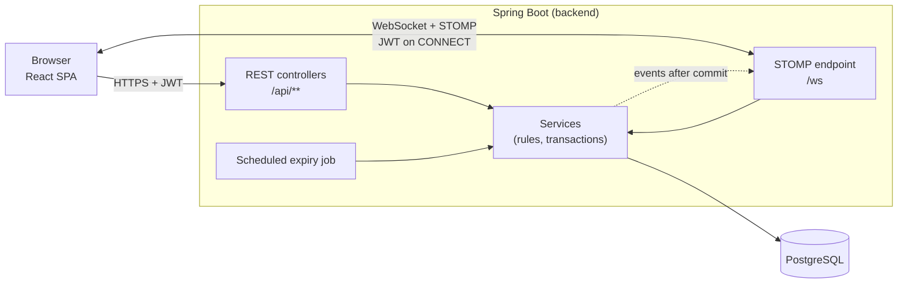
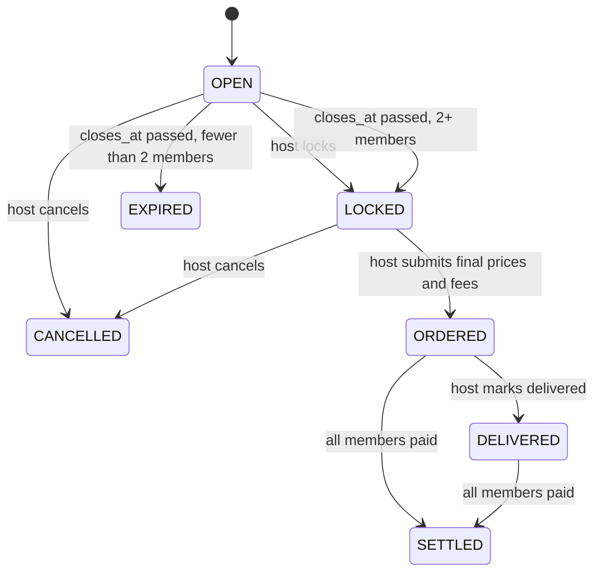

# Pollenz

[](https://github.com/Samarpan-algo/pollenz/actions/workflows/ci.yml)

Quick-commerce apps such as Blinkit, Instamart and Zepto charge delivery and handling fees on small
orders and set a minimum order value for free delivery. Students in the same hostel often order
small amounts separately and pay the fees several times. Pollenz lets one person (the host) open a
pool for a platform, lets others in the same community add their items to it, and splits the final
bill between everyone.

Pollenz does not integrate with any quick-commerce API or payment gateway. The host places the real
order by hand in the delivery app. Pollenz handles discovery, item collection, the bill split and
payment tracking, and members pay the host through UPI links that the app builds for them.

Full API and behaviour contract: [docs/SPEC.md](docs/SPEC.md).

## Features

- Registration and login with JWT; optional UPI id on the profile.
- Communities (a hostel or society) joined with an 8-character invite code.
- Pools per community with a platform, title, target amount, closing time and pickup spot.
- Members add, edit and remove their own items with estimated prices while the pool is open.
- Pool lifecycle: open, locked, ordered, delivered, settled, plus cancelled and expired.
  A scheduled job locks or expires pools whose closing time has passed.
- Bill split after the host enters final item prices and the shared fees.
- Payment tracking: members get a `upi://pay` link for the host; the host marks each member as paid;
  the pool settles automatically once everyone has paid.
- Live updates and a per-pool chat over STOMP/WebSocket.
- OpenAPI documentation with Swagger UI.

## Tech stack

| Layer | Choice |
| --- | --- |
| Backend | Java 21, Spring Boot 4.1.2, Spring Web MVC, Bean Validation |
| Persistence | PostgreSQL 17, Spring Data JPA (Hibernate), Flyway |
| Security | Spring Security, stateless JWT (HS256, jjwt 0.13), BCrypt |
| Realtime | Spring WebSocket with STOMP |
| API docs | springdoc-openapi 3.2 (Swagger UI) |
| Backend tests | JUnit 5, Spring Boot Test, Testcontainers (PostgreSQL) |
| Frontend | React 19, Vite, Tailwind CSS 4, React Router, `@stomp/stompjs` |
| Frontend tests and lint | Vitest, oxlint |
| CI | GitHub Actions |
| Hosting (free tiers) | Render (API, Docker), Neon (PostgreSQL), Vercel (frontend) |

## Architecture



The backend is organised by feature, not by layer. Under `backend/src/main/java/com/pollenz/`:

- `auth`, `user`, `community`, `pool`, `chat`: each holds its own controller, service, repository,
  entity and DTOs (Java records).
- `common`: the shared error type and the `@RestControllerAdvice` that produces one JSON error shape.
- `config`: security, WebSocket, OpenAPI, clock and scheduling configuration.

Controllers are thin and the rules live in services. Schema changes live in
`backend/src/main/resources/db/migration`.

Pool lifecycle (see the SPEC for the full rules):



## Engineering notes

**Concurrency on pool writes.** Every write to a pool, its members or its items first loads the pool
with `SELECT ... FOR UPDATE` (`PESSIMISTIC_WRITE` in `PoolRepository`), then checks status and
ownership, so writes to one pool are serialized. Two backstops remain: the unique constraint on
`(pool_id, user_id)` and a `@Version` column on the pool, which turns a lost update into a 409
`CONCURRENT_UPDATE`. `PoolConcurrencyIntegrationTest` exercises this with parallel requests.

**Money is integer paise.** Amounts are `long` paise in the API, Java and the database; there is no
floating point. The bill split (`BillSplit`) gives each member their item total plus
`fees / memberCount` (integer division) and adds the remainder paise to the host. The sum of all
shares therefore equals the sum of final item totals plus fees exactly. The code checks that
invariant and uses `Math.addExact`, so an overflow fails loudly instead of wrapping.

**Events after commit.** Services publish a domain event, and a `@TransactionalEventListener` on
`AFTER_COMMIT` turns it into a STOMP message. Clients never hear about a change that is later rolled
back. Events carry only ids and status; clients refetch pool detail over REST, and the host's UPI id
is never sent through the socket.

**Auth on HTTP and STOMP.** A filter validates the JWT on REST requests. For WebSocket, the STOMP
`CONNECT` frame must carry `Authorization: Bearer <jwt>`, and an interceptor then authorises each
`SUBSCRIBE` and `SEND` against pool membership, so only members of a pool can read or post to its
topic. A rejected frame gets an ERROR frame and the connection closes. The handshake origin is
restricted to the configured `CORS_ORIGIN`.

**Schema under version control.** Flyway owns the schema (`V1__init.sql`,
`V2__pool_checks_and_expiry_index.sql`) and Hibernate runs with `ddl-auto: validate`, so a mismatch
between entities and migrations stops the app at startup instead of drifting.

**Tests against real PostgreSQL.** Integration tests run the full application against PostgreSQL in
Testcontainers, not H2, covering auth, communities, pools, settlement, expiry, chat and the
WebSocket flow. The concurrency tests fire simultaneous requests at one pool. The backend has 111
tests; the frontend has unit tests for money formatting and WebSocket URL building.

## API overview

All routes are under `/api` and need `Authorization: Bearer <jwt>` except register and login.
Errors use `{ "status", "error", "message" }`.

| Method | Path | Purpose |
| --- | --- | --- |
| POST | `/auth/register` | Create an account, returns token and user |
| POST | `/auth/login` | Log in, returns token and user |
| GET | `/users/me` | Current user |
| PATCH | `/users/me` | Update name or UPI id |
| POST | `/communities` | Create a community (creator becomes admin) |
| POST | `/communities/join` | Join with an invite code |
| GET | `/communities` | Communities I belong to |
| GET | `/communities/{id}` | Community detail with members |
| POST | `/communities/{id}/pools` | Open a pool |
| GET | `/communities/{id}/pools?status=` | List pools |
| GET | `/pools/{id}` | Pool detail: members, items, shares |
| POST | `/pools/{id}/join` | Join a pool |
| DELETE | `/pools/{id}/leave` | Leave a pool |
| POST | `/pools/{id}/items` | Add an item |
| PUT | `/pools/{id}/items/{itemId}` | Edit an item |
| DELETE | `/pools/{id}/items/{itemId}` | Remove an item |
| POST | `/pools/{id}/lock` | Host locks the pool |
| POST | `/pools/{id}/cancel` | Host cancels the pool |
| POST | `/pools/{id}/order` | Host submits final prices and fees; shares are computed |
| POST | `/pools/{id}/deliver` | Host marks the order delivered |
| POST | `/pools/{id}/members/{memberId}/paid` | Host marks a member as paid |
| GET | `/pools/{id}/messages` | Chat history |

Realtime: STOMP at `/ws`; subscribe to `/topic/pools/{id}`, send chat to `/app/pools/{id}/chat`.

Swagger UI is at `/swagger-ui.html` and the OpenAPI document at `/v3/api-docs`; for a local run,
http://localhost:8080/swagger-ui.html. Health check: `/actuator/health`.

## Running locally

Prerequisites: JDK 21, Node.js (current LTS) with npm, and Docker (for the database and for the
backend tests). The Maven wrapper is included.

1. Start PostgreSQL. It is published on host port **5433**; database, user and password are all
   `pollenz`.

   ```text
   docker compose up -d
   ```

2. Start the backend on port 8080. Flyway creates the schema on first start.

   ```powershell
   cd backend
   .\mvnw.cmd spring-boot:run
   ```

   ```bash
   cd backend
   ./mvnw spring-boot:run
   ```

3. Start the frontend on port 5173. The dev server proxies `/api` and `/ws` to port 8080.

   ```text
   cd frontend
   npm ci
   npm run dev
   ```

Open http://localhost:5173.

Tests and checks (the backend tests need Docker running, because Testcontainers starts PostgreSQL):

```powershell
cd backend; .\mvnw.cmd -B clean verify
cd ..\frontend; npm run lint; npm test; npm run build
```

```bash
(cd backend && ./mvnw -B clean verify)
(cd frontend && npm run lint && npm test && npm run build)
```

Configuration is by environment variable; see [`.env.example`](.env.example). Local defaults are in
`backend/src/main/resources/application.yml`. The default JWT secret is for development only.

## Deployment

The files in this repo target the free tiers of Neon, Render and Vercel.

1. **Neon (database).** Create a project and database. Build the connection string in JDBC form,
   not the `postgresql://` URI that Neon shows: `jdbc:postgresql://<host>/<db>?sslmode=require`.
   Pass the user and password separately as `DB_USER` and `DB_PASSWORD`.
2. **Render (API).** Create a Blueprint from this repo; it reads [`render.yaml`](render.yaml) and
   builds `backend/Dockerfile`. Provide the five variables the blueprint declares without values:
   `DB_URL`, `DB_USER`, `DB_PASSWORD`, `JWT_SECRET` (at least 32 random bytes) and `CORS_ORIGIN`.
   The service listens on Render's `PORT` and is checked at `/actuator/health`. The free plan sleeps
   when idle, so the first request after a pause is slow.
3. **Vercel (frontend).** Import the repo with the root directory set to `frontend`. Set
   `VITE_API_URL` (for example `https://<service>.onrender.com/api`) and `VITE_WS_URL`
   (`wss://<service>.onrender.com/ws`) before building.
   [`frontend/vercel.json`](frontend/vercel.json) rewrites all paths to `index.html` so
   client-side routes work on refresh.
4. **Close the loop.** Set `CORS_ORIGIN` on Render to the exact deployed frontend origin, for example
   `https://pollenz.vercel.app` (no trailing slash, no path). It is used for CORS and also for the
   WebSocket handshake, so a mismatch breaks both API calls and live updates.

## Limitations and next steps

- Payments are tracked, not processed: the host marks members as paid by hand after checking their
  UPI app. There is no gateway and no verification.
- No integration with quick-commerce apps: prices are entered by the members and the host.
- No email, password reset, notifications outside the open page, or moderation tools.
- Chat history returns the latest 200 messages and is not paginated.
- The in-memory STOMP broker works for a single instance only; scaling out would need an external
  broker.
- Possible next steps: refresh tokens, rate limiting on auth routes, push or email notifications,
  end-to-end browser tests in CI.
